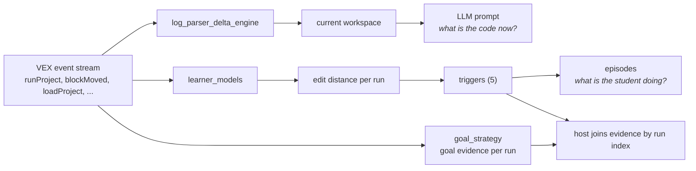

# agent-lm-packages

This repository has three small, **pure** Python packages. They change the block event stream of a
VEX (VEXcode VR) student into data that an agent can use:

- The current workspace
- Behavioral triggers
- Goal evidence with explicit uncertainty

The packages use no database and no web framework. Each package takes plain data and returns plain
data, so any host (reflecks, the agent server, a notebook) can drive them.

Each folder has its own README. To install all three packages, run `pip install .` from the
repository root.

## The three packages

| Folder | What it does | Deps | Status |
|---|---|---|---|
| [`log_parser_delta_engine/`](log_parser_delta_engine/) | Rebuilds the current VEX workspace from a log stream (or one project XML). Renders the workspace as pseudo-code (compact and readable), with live code split from orphans. | stdlib | populated |
| [`learner_models/`](learner_models/) | Per-run edit distances (APTED), the 5 behavioral triggers, and session episodes. | `apted` | populated |
| [`goal_strategy/`](goal_strategy/) | Goal profiles, simulation, timelines, sensor battery and optional review tools. | `pyyaml`, plus analysis/UI extras | populated |

## How they fit together



## Two workspace renderers

Both renderers are in `log_parser_delta_engine`. They render the same VEX workspace as pseudo-code,
for two audiences. The names use one pattern, `generate_<style>_<form>`, so the name of a call shows
which renderer it needs.

| Renderer | Audience | What it does |
|---|---|---|
| `generate_compact_prompt` (standalone) / `smart_delta_engine.generate_compact_prompt()` (method) | LLM | Makes a token-cheap listing split into `[Active]` (a hat stack or a called My Block) and `[Orphaned]`. Removes noisy `pg_`/`aim_`/`mixed_` prefixes. Does no name lookup. Folds value-slot literals (drive distance, turn degrees) into parent fields. |
| `generate_readable_text` / `generate_readable_lines` | Human | Uses full display names from `vex_blocks.json`, infix operators (`A < B`), tidied enums (`fwd` to `forward`), inline reporter values and `else:` branch labels. Shows live stacks first, and orphans after them under `not connected (won't run):`. |

Each renderer also has a `_from_content` variant, for example
`generate_compact_prompt_from_content`. This variant takes a parsed VEX log content dict and
extracts the workspace XML internally.

Use **compact** when you build an LLM prompt, to spend tokens on structure and not on prose. Use
**readable** when you show the code to a person.

## Data contract (what you feed in)

The integration APIs read the same parsed VEX log event, a dict with three keys:

```python
{"event_type": "runProject",        # str,   the VEX eventType
 "content": {...parsed VEX log...}, # dict,  carries project.workspace + playground
 "ts": 1690000000.0}                # float, epoch seconds (or None)
```

Each function reads only what it needs:

| Function | Reads | Returns |
|---|---|---|
| `compute_run_edit_distances(events)` | `runProject` events, their `content` (`project.workspace`, `playground`) and `ts` | `{"runs": [{"index", "edit_distance", "ts", "playground"}]}` |
| `detect_run_triggers_by_playground(runs)` | the `runs` list above | `[(trigger_type, run_index, detail)]` |
| `segment_session(events)` | every event's `event_type` + `ts` (ignores `content`) | `(episodes, pauses)` |
| `generate_compact_prompt(xml_string)` | one workspace XML string | pseudo-code `str`, or `None` if empty |
| `generate_compact_prompt_from_content(content)` | parsed VEX log content dict | pseudo-code `str`, or `None` if empty |

The host supplies these events, through an adapter from wherever it stores them. Nothing in this
repository touches a DB. The one stateful trigger, `inactive`, leaves its two DB touch-points to
the caller. See [`learner_models/README.md`](learner_models/README.md).

[`examples/end_to_end.py`](examples/end_to_end.py) is a runnable walkthrough. It feeds synthetic
event streams through all three packages. Goal evidence does not select feedback or change
learner-model triggers.

A host can also produce goal evidence **online**, one event at a time, to get a profile the moment
each run finishes. `goal_strategy.GoalProfileStream` receives events as they arrive. It gives the
same runs that the batch call produces for the same prefix. See
[`examples/realtime.py`](examples/realtime.py) and the goal_strategy README.

## Install / test

```bash
pip install .                            # Python 3.10+, all three core packages
python test_smoke.py                     # original 40 sibling-package tests
python examples/end_to_end.py            # narrated walkthrough with real output
python examples/realtime.py              # online goal profiling, event by event
```

For standalone goal validation, install `.[dev]` and run `python -m pytest -q -m "not corpus"`.
[goal_strategy/README.md](goal_strategy/README.md) covers associated-outcome APIs, optional tools,
external data paths and full-corpus qualification.
